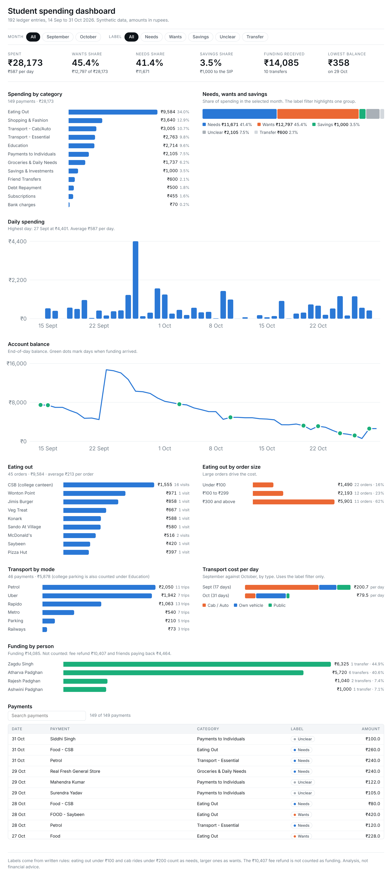
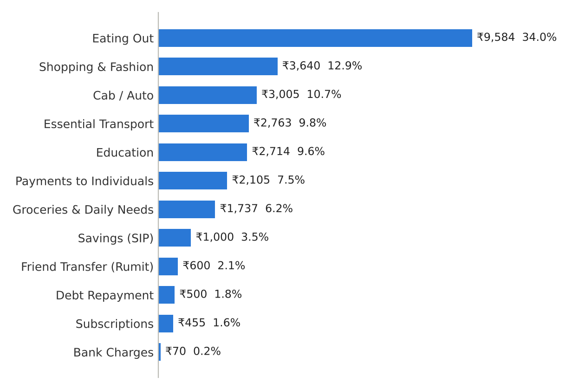
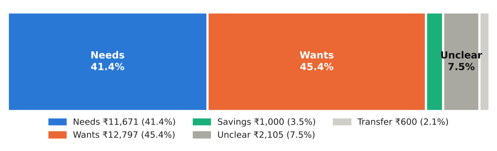
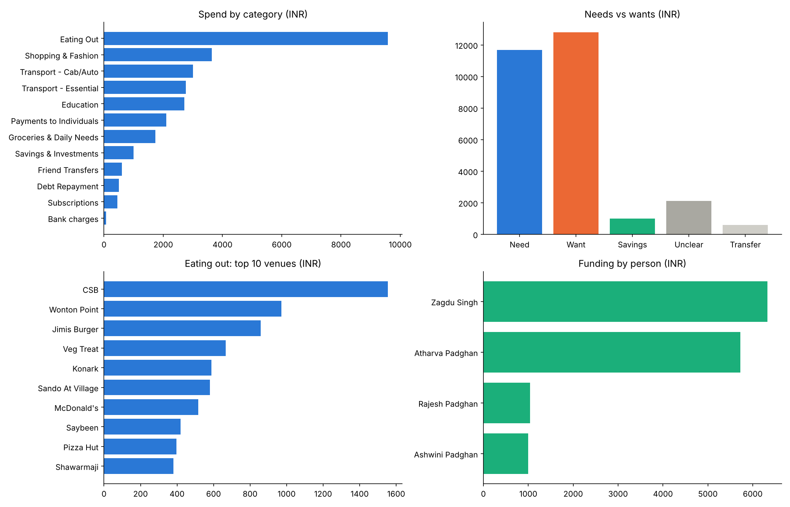
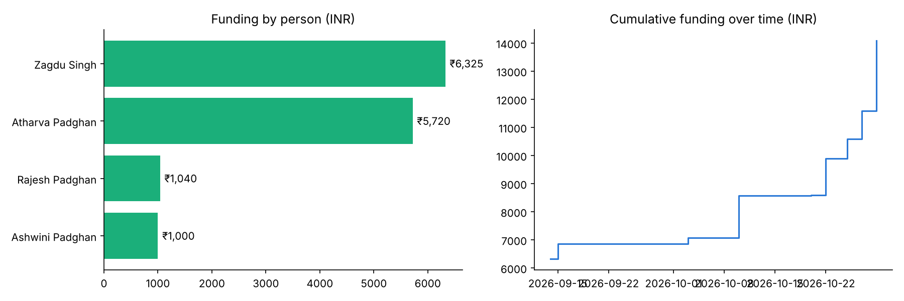
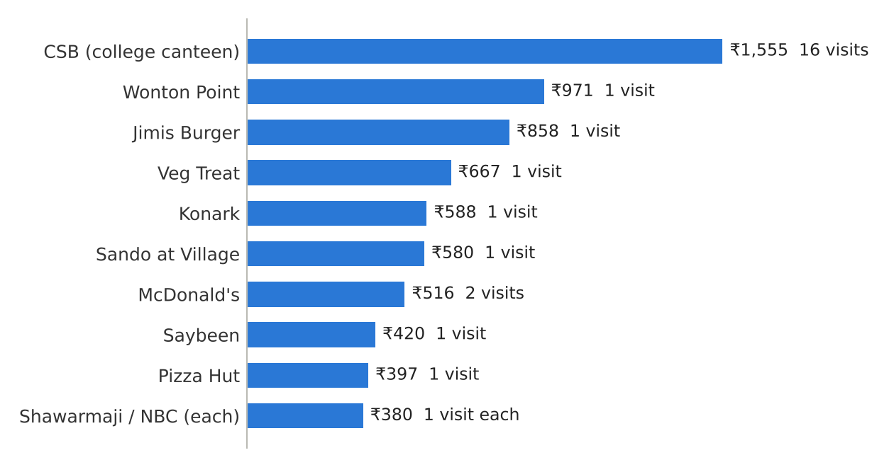
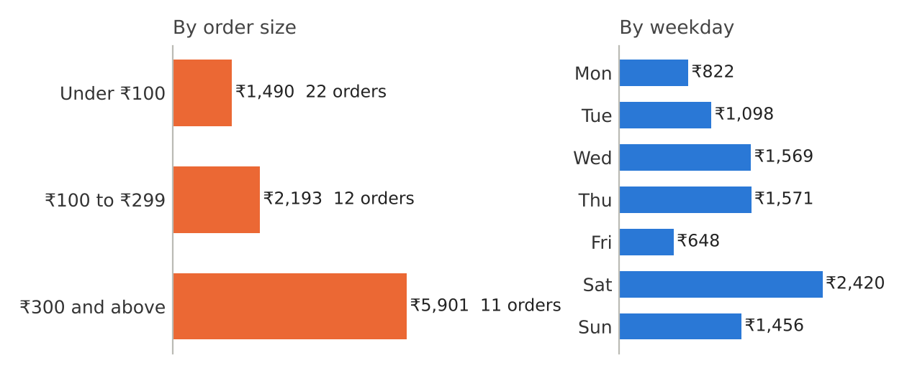
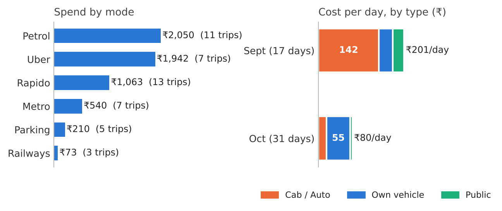
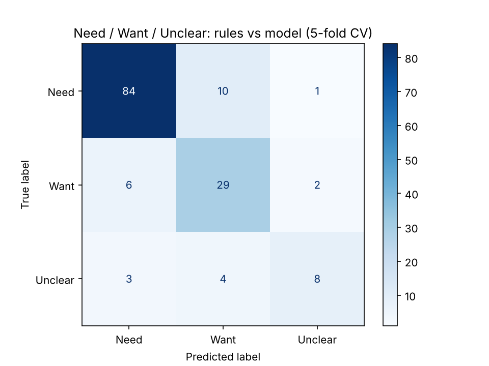

# Student Spending Behaviour Analysis

A data analysis project that cleans a student's bank ledger, sorts every payment into needs, wants and savings, finds the unhealthy spending patterns, and proposes a quantified plan for spending more efficiently.

The analysis is a Python notebook that runs end to end in Google Colab or locally. It uses a **partially synthetic** ledger of 192 entries covering 14 September to 31 October 2026 (48 days).



## Contents

- [Project goals](#project-goals)
- [Key findings](#key-findings)
- [Repository contents](#repository-contents)
- [Getting started](#getting-started)
- [How the analysis works](#how-the-analysis-works)
- [Customising the analysis](#customising-the-analysis)
- [Figures](#figures)
- [Data](#data)
- [Limitations](#limitations)
- [Tools and references](#tools-and-references)
- [Author](#author)

## Project goals

1. Clean the ledger and check that its running balance is internally consistent.
2. Categorise every transaction and separate necessary spending (needs) from unnecessary spending (wants), with savings treated on its own.
3. Analyse the two most important categories, eating out and transport, in detail.
4. Analyse the sources of funding, including how much each individual provided.
5. Identify unhealthy spending patterns and propose a realistic reduction plan.

## Key findings

| Measure | Result |
|---|---|
| Total spent (149 debits) | ₹28,173 (about ₹17,600 a month) |
| Needs / Wants / Savings | 41.4% / 45.4% / 3.5% |
| Unidentified payments and friend transfers | 7.5% and 2.1% |
| Largest category | Eating out, ₹9,584 (34.0%) |
| Eating out driven by | 11 orders of ₹300 or more, which make up 61.6% of the category |
| Transport | ₹5,878; cost per day fell 60% from September to October as cab use gave way to the student's own vehicle |
| Total funding | ₹14,085 from four people (Padghan family 55.1%, Zagdu Singh 44.9%) |
| Inflows without the ₹10,407 fee refund | ₹18,575, about two thirds of spending |
| Proposed reduction | About ₹3,560 a month, bringing wants down to roughly 31.6% of spending |
| Label consistency (5-fold cross-validation) | 82% agreement between the rules and a classifier |

Funding by person:

| Funder | Transfers | Total | Share |
|---|---|---|---|
| Zagdu Singh | 1 | ₹6,325 | 44.9% |
| Atharva Padghan | 6 | ₹5,720 | 40.6% |
| Rajesh Padghan | 2 | ₹1,040 | 7.4% |
| Ashwini Padghan | 1 | ₹1,000 | 7.1% |

The full discussion, tables and figures are in the two reports listed below.

## Repository contents

| File | What it is |
|---|---|
| `Financial_Ledger_Data_Analysis.ipynb` | The full analysis: cleaning, categorising, eating out, transport, funding, reduction plan and label check |
| `Financial_Ledger_ September & October.xlsx` | The ledger (partially synthetic) |
| `Spending_Behaviour_Academic_Report.pdf` | 17-page academic project report |
| `Financial Ledger Report.pdf` | 6-page summary report |
| `dashboard_web.png` | Static image of the spending dashboard |
| `cat.png`, `nature.png`, `eat_venue.png`, `eat_tier.png`, `transport.png`, `funding.png`, `ledger_overview.png`, `confusion_matrix.png` | Figures produced by the notebook |

## Getting started

The notebook needs Python 3 with pandas, numpy, matplotlib, scikit-learn and openpyxl. Google Colab already includes all of them.

### Run in Google Colab (recommended)

1. Open the notebook in Colab: [Open in Colab](https://colab.research.google.com/github/aadityapadghan06/Analysing-Student-Spending-Behaviour-From-A-Bank-Ledger/blob/main/Financial_Ledger_Data_Analysis.ipynb).
2. Upload `Financial_Ledger_ September & October.xlsx` to the `sample_data` folder in the Files panel on the left, so that it sits at `/content/sample_data/Financial_Ledger_ September & October.xlsx`. The notebook reads the ledger from that path.
3. Choose **Runtime > Run all**.

### Run locally

```bash
pip install pandas numpy matplotlib scikit-learn openpyxl jupyter
jupyter notebook Financial_Ledger_Data_Analysis.ipynb
```

The notebook reads the ledger from `/content/sample_data/...`, which only exists in Colab. Before running it locally, change that path to the location of the `.xlsx` file in every `pd.read_excel(...)` call and in the `FILE = ...` line.

## How the analysis works

The notebook follows these steps in order, and each has its own markdown heading.

| Step | What it does |
|---|---|
| Data cleaning | Standardises mixed date formats, cleans text and numbers, builds a signed amount, checks each balance against the previous balance plus the entry, and tags funders |
| Categorising | Assigns each debit to one of twelve categories using an ordered table of keyword patterns (`RULES`); category totals are checked against the ledger total |
| Needs and wants | Labels each debit as need, want, savings, transfer or unclear; eating out and cab rides are split by payment size |
| Eating out | Venue, order size, weekday and month |
| Transport | Mode and type; months compared per day because September starts on the 14th |
| Funding | Tags each credit as funding, fee refund, friend reimbursement or bank credit; funding summed by person with a timeline |
| Reduction plan | Applies a percentage cut to each want category (`cuts`) and reports the saving per month |
| Label check (confusion matrix) | Trains a logistic regression on the description, amount and weekday, and evaluates it with stratified 5-fold cross-validation |

## Customising the analysis

The parts most worth changing are in the notebook cells named below:

- **`RULES`** is the category table. Add or edit a pattern to move payments between categories.
- **The `need_want` function** holds the payment sizes below which eating out (under ₹100) and cab rides (under ₹200) count as needs.
- **`cuts`** holds the reduction percentage for each want category: eating out 40%, shopping and fashion 50%, cab and auto 60%, subscriptions 25%.
- **The "Tag the funders" cell** decides who counts as a funder.

After any change, rerun the notebook and every table and chart updates.

## Figures

| | |
|---|---|
|  |  |
| Spending by category | Needs, wants and savings |
|  |  |
| Ledger overview | Funding by person |
|  |  |
| Eating out by venue | Eating out by order size |
|  |  |
| Transport | Label check: confusion matrix |

## Data

`Financial_Ledger_ September & October.xlsx` is a partially synthetic ledger. It has five columns: Date, Particulars, Debit, Credit and Balance. The analysis treats it as a genuine ledger.

Interpretation notes that the code relies on:

- Credits from the Padghan family and from Zagdu Singh are funding.
- A ₹10,407 credit labelled "College" is a fee refund from Zagdu Singh. It is reported separately and is not counted as income.
- Swarg is a gift shop, Rumit is a friend, and a payment to Nileshbhai Mali repaid a debt.

To use your own ledger, keep the same five columns and update the name rules in the notebook.

## Limitations

- Forty-eight days is too short to show long-run or seasonal habits, and September covers only 17 days.
- The ledger is partially synthetic, so the findings describe this dataset and do not generalise to other students.
- The needs and wants split depends on the thresholds above, so the wants share is an estimate.
- Fifteen payments (₹2,105) go to individuals whose purpose is unknown and sit outside the needs and wants split.
- Six balances do not reconcile with the entries around them (net about ₹65). Amounts were left unchanged.
- The classifier is trained on labels produced by the rules, so its 82% agreement shows how consistent the rules are, not whether they match the student's own judgement.

## Tools and references

- pandas: McKinney, W. (2010). Data structures for statistical computing in Python. *Proceedings of the 9th Python in Science Conference*, 51–56.
- matplotlib: Hunter, J. D. (2007). Matplotlib: A 2D graphics environment. *Computing in Science & Engineering*, 9(3), 90–95.
- scikit-learn: Pedregosa, F., et al. (2011). Scikit-learn: Machine learning in Python. *Journal of Machine Learning Research*, 12, 2825–2830.
- The needs, wants and savings framing follows the 50/30/20 rule of thumb in Warren, E., & Tyagi, A. W. (2005). *All your worth: The ultimate lifetime money plan*. Free Press. It is applied here to shares of spending, not income, so treat it as indicative.

## Author

Aaditya Rajesh Padghan
